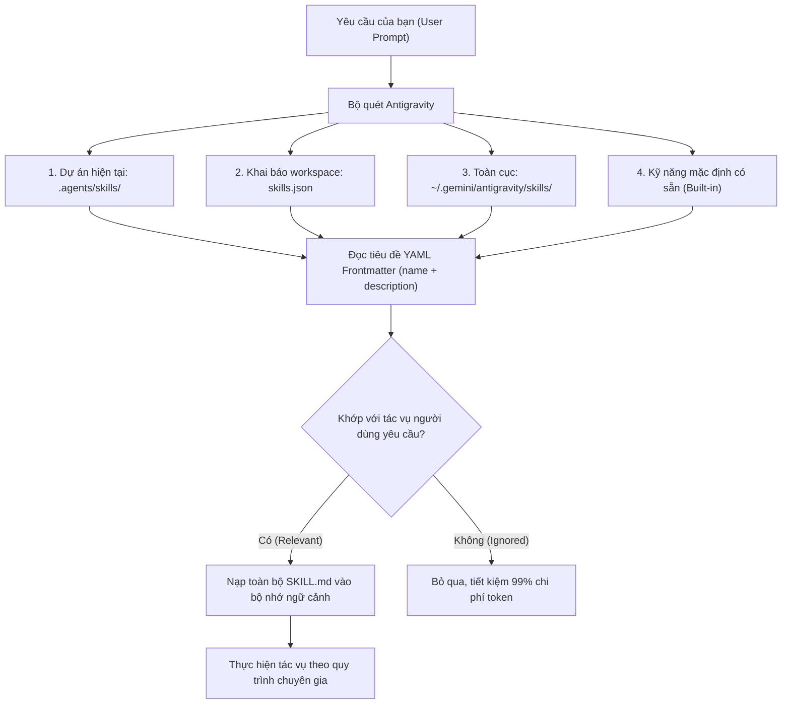

# 🇻🇳 Vietnam Agentic Skills (VAS)

> **Kho lưu trữ 2,650+ kỹ năng (agentic skills) chuyên sâu được tối ưu hoá riêng cho Google Antigravity.**  
> **100% Zero-NPX. Không phụ thuộc Node.js hay NPM Registry. Tốc độ thực thi siêu tốc với Python 3 chuẩn.**

[](https://github.com/huytran1120/vietnam-agentic-skills)
[](https://huytran1120.github.io/vietnam-agentic-skills/)
[](CATALOG.md)
[](vas.py)
[](https://github.com/huytran1120)
[](LICENSE)

> 🌐 **Trải nghiệm tìm kiếm và tra cứu trực tiếp trên web**: [https://huytran1120.github.io/vietnam-agentic-skills/](https://huytran1120.github.io/vietnam-agentic-skills/)

---

## 📌 Mục Lục (Table of Contents)

- [1. Giới Thiệu (Overview)](#1-giới-thiệu-overview)
- [2. Vì Sao Chọn Vietnam Agentic Skills?](#2-vì-sao-chọn-vietnam-agentic-skills)
- [3. Cài Đặt & Sử Dụng Nhanh (Quickstart)](#3-cài-đặt--sử-dụng-nhanh-quickstart)
- [4. Cách Google Antigravity Hoạt Động Với Skills](#4-cách-google-antigravity-hoạt-động-với-skills)
- [5. Cẩm Nang Tra Cứu Lệnh CLI (`./vas`)](#5-cẩm-nang-tra-cứu-lệnh-cli-vas)
- [6. Các Kịch Bản Sử Dụng Điển Hình](#6-các-kịch-bản-sử-dụng-điển-hình)
- [7. Cấu Trúc Chuẩn Của Một Skill](#7-cấu-trúc-chuẩn-của-một-skill)
- [8. Danh Mục Kỹ Năng Nổi Bật](#8-danh-mục-kỹ-năng-nổi-bật)
- [9. Câu Hỏi Thường Gặp (FAQ)](#9-câu-hỏi-thường-gặp-faq)
- [10. Tác Giả & Giấy Phép](#10-tác-giả--giấy-phép)

---

## 1. Giới Thiệu (Overview)

**Vietnam Agentic Skills (VAS)** là dự án thư viện kỹ năng agentic mã nguồn mở được khởi xướng và phát triển bởi **Huy Tran** ([@huytran1120](https://github.com/huytran1120)). 

Dự án đóng gói **hơn 2,650 playbooks (`SKILL.md`)** chuyên sâu thuộc 115 danh mục công nghệ, được thiết kế theo đúng chuẩn quy cách mở rộng của **Google Antigravity**, biến AI Assistant thành một cộng sự đắc lực có thể giải quyết các tác vụ kỹ thuật phức tạp từ kiến trúc hệ thống, kiểm toán bảo mật, devops, kiểm thử tự động, đến lập trình fullstack và AI/ML.

---

## 2. Vì Sao Chọn Vietnam Agentic Skills?

So sánh giữa giải pháp gốc sử dụng `npx` (`agentic-awesome-skills`) và **Vietnam Agentic Skills (VAS)**:

| Tiêu Chí | Upstream (`agentic-awesome-skills`) | Vietnam Agentic Skills (VAS) |
| :--- | :--- | :--- |
| **Công cụ thực thi** | Bắt buộc cài đặt Node.js & gọi `npx` | **Native Python 3 CLI (`./vas`)** dùng thư viện chuẩn |
| **Phụ thuộc bên ngoài** | Cần kết nối NPM Registry, mạng Internet | **Zero Dependencies**: Chạy 100% offline nội bộ |
| **Tốc độ phản hồi** | 3s - 15s mỗi lần chạy lệnh qua npx | **< 0.1 giây** (phản hồi tức thì) |
| **Hệ điều hành hỗ trợ** | Cần môi trường JavaScript runtime | **Tương thích macOS, Linux, Windows** có sẵn Python 3 |
| **Mục tiêu chính** | Hỗ trợ chung cho nhiều AI IDE | **Tối ưu hoá sâu cho Google Antigravity** |
| **Cơ chế cài đặt** | Copy file thủ công vào thư mục | Hỗ trợ cả **Symlink** (`--mode link`) và **Deep Copy** |
| **Bảo toàn ngữ cảnh** | Dễ gây phình token nếu nạp sai | Tuân thủ tuyệt đối **Progressive Disclosure** |

---

## 3. Cài Đặt & Sử Dụng Nhanh (Quickstart)

### Bước 1: Clone kho lưu trữ về máy
```bash
git clone https://github.com/huytran1120/vietnam-agentic-skills.git
cd vietnam-agentic-skills
chmod +x vas vas.py
```

### Bước 2: Tìm kiếm kỹ năng bạn cần
```bash
# Tìm kiếm kỹ năng theo từ khóa
./vas search docker-security

# Liệt kê các kỹ năng trong nhóm bảo mật
./vas list --category security --limit 10

# Xem các danh mục có sẵn
./vas categories
```

### Bước 3: Cài đặt vào Google Antigravity

#### Cách A: Cài đặt cho Dự án Hiện tại (Workspace Target - Khuyên dùng)
Kỹ năng sẽ được cài vào `.agents/skills/<skill_id>` trong dự án của bạn:
```bash
# Cài đặt bằng Symlink (tiết kiệm ổ cứng, tự động cập nhật khi repo update)
./vas install docker-security --target workspace --mode link

# Cài đặt nhiều kỹ năng cùng lúc
./vas install 007 react-performance fastapi-best-practices --target workspace
```

#### Cách B: Cài đặt Toàn cục (Global Target)
Kỹ năng sẽ có mặt ở **mọi dự án** bạn mở bằng Google Antigravity (`~/.gemini/antigravity/skills/`):
```bash
./vas install 007 --target global
```

### Bước 4: Kiểm tra trạng thái kỹ năng đã cài
```bash
./vas status
```

---

## 4. Cách Google Antigravity Hoạt Động Với Skills

Google Antigravity quản lý và nạp kỹ năng thông qua cơ chế phân cấp ưu tiên và **Progressive Disclosure** (tiết lộ lũy tiến):



> [!TIP]
> **Nguyên tắc Tiết lộ Lũy tiến (Progressive Disclosure):**  
> Dù bạn có liên kết hàng trăm kỹ năng, Antigravity chỉ đọc phần `name` và `description` ngắn gọn ở đầu file. Chỉ khi bạn yêu cầu thực hiện tác vụ liên quan (ví dụ: *"hãy audit bảo mật container này"*), Antigravity mới nạp quy trình chi tiết từ `SKILL.md` vào ngữ cảnh.

---

## 5. Cẩm Nang Tra Cứu Lệnh CLI (`./vas`)

Bộ công cụ `./vas` được thiết kế theo phong cách CLI hiện đại, có màu sắc trực quan:

```text
Cú pháp chung:
  ./vas <sub-command> [arguments] [options]
  (hoặc python3 vas.py <sub-command> ...)
```

### 1. `search` — Tìm kiếm kỹ năng
Tìm kiếm từ khóa trong tên, ID, mô tả, danh mục và thẻ phân loại:
```bash
./vas search kubernetes
./vas search "react performance" --limit 15
```

### 2. `list` — Liệt kê kỹ năng có bộ lọc
```bash
# Xem danh sách theo nhóm danh mục
./vas list --category ai-ml

# Xem danh sách theo tag
./vas list --tag python --limit 20
```

### 3. `show` / `info` — Xem chi tiết & Xem trước nội dung
Hiển thị metadata, tác giả, mức độ rủi ro và xem trước 40 dòng đầu của file `SKILL.md`:
```bash
./vas show 007
./vas show docker-security
```

### 4. `categories` & `tags` — Khám phá hệ thống
```bash
# Xem 115 danh mục kỹ năng và số lượng
./vas categories

# Xem các tag phổ biến nhất
./vas tags --limit 30
```

### 5. `install` — Cài đặt vào Antigravity
```bash
# Cài 1 hoặc nhiều kỹ năng cụ thể
./vas install 007 git-rebase-interactive --target workspace --mode link

# Cài đặt toàn bộ kỹ năng thuộc 1 chuyên mục
./vas install --category devops --target workspace

# Cài đặt theo tag
./vas install --tag aws --target workspace

# Cài đặt vào thư mục tuỳ ý
./vas install 007 --dest /path/to/custom/agents/skills
```

**Các tuỳ chọn của `install`:**
* `--target workspace`: Cài vào `.agents/skills` của dự án hiện tại (mặc định).
* `--target global`: Cài vào `~/.gemini/antigravity/skills/` dùng chung cho toàn máy.
* `--mode link`: Tạo symbolic link (nhẹ, nhanh, tự cập nhật).
* `--mode copy`: Sao chép toàn bộ thư mục sang đích.

### 6. `uninstall` / `remove` — Gỡ bỏ kỹ năng
```bash
./vas uninstall 007 --target workspace
./vas uninstall docker-security --target global
```

### 7. `status` — Kiểm tra kỹ năng đã cài
```bash
./vas status
./vas status --target global
```

### 8. `init` — Khởi tạo thư mục cho dự án bên ngoài
Di chuyển vào bất kỳ thư mục dự án nào và chạy lệnh để kích hoạt VAS cho Antigravity:
```bash
cd /path/to/my-awesome-project
/path/to/vietnam-agentic-skills/vas init
```

### 9. `sync` — Tái lập chỉ mục (Rebuild Index)
Tự động quét lại thư mục `skills/` và tái tạo file chỉ mục `skills_index.json`:
```bash
./vas sync
```

---

## 6. Các Kịch Bản Sử Dụng Điển Hình

### Kịch bản 1: Kiểm toán Bảo Mật Toàn Diện (Security Audit)
Bạn cần kiểm tra bảo mật mã nguồn, phân tích lỗ hổng OWASP và mô hình hoá đe dọa (STRIDE):
```bash
./vas install 007 --target workspace --mode link
```
*Prompt trong Antigravity:*
> *"Hãy chạy kiểm tra bảo mật theo chuẩn 007 cho toàn bộ source code hiện tại, đánh giá lỗ hổng injection và secrets leakage."*

---

### Kịch bản 2: Tối ưu hoá Backend FastAPI & Clean Architecture
Bạn đang xây dựng một microservice backend bằng Python:
```bash
./vas install fastapi-best-practices python-patterns --target workspace
```
*Prompt trong Antigravity:*
> *"Tái cấu trúc thư mục API này theo chuẩn Clean Architecture và tối ưu hóa xử lý async theo fastapi-best-practices."*

---

### Kịch bản 3: Tăng tốc Frontend React / Next.js
Bạn muốn cải thiện chỉ số Core Web Vitals và phát hiện re-render không cần thiết:
```bash
./vas install react-performance nextjs-perf --target workspace
```
*Prompt trong Antigravity:*
> *"Kiểm tra file page.tsx này và đề xuất tối ưu hóa re-render, áp dụng memoization và dynamic imports."*

---

### Kịch bản 4: Trang bị Full Bộ Kỹ Năng DevOps
Bạn đang thiết lập hệ thống triển khai CI/CD với Docker và Kubernetes:
```bash
./vas install --category devops --target workspace
```
Toàn bộ các playbooks về Dockerfile hardening, Kubernetes YAML linter, Helm chart best practices sẽ sẵn sàng để Antigravity tra cứu.

---

## 7. Cấu Trúc Chuẩn Của Một Skill

Mỗi kỹ năng trong thư mục `skills/<skill_name>/` tuân thủ nghiêm ngặt cấu trúc mở rộng của Antigravity:

```text
skills/<skill_name>/
├── SKILL.md          # [Bắt buộc] Frontmatter YAML + Bản hướng dẫn quy trình
├── scripts/          # [Tuỳ chọn] Script tự động hóa (Python, Bash)
├── examples/         # [Tuỳ chọn] File mẫu, đầu vào / đầu ra tham khảo
└── references/       # [Tuỳ chọn] Checklist chi tiết hoặc tài liệu chuyên sâu
```

### Cấu trúc tiêu chuẩn của `SKILL.md`:
```markdown
---
name: my-specialized-skill
category: devops
tags: [docker, security, hardening]
risk: safe
description: >-
  Use this skill when auditing Dockerfile or container configurations
  against security vulnerabilities, root execution, and secret leaks.
---

# My Specialized Skill

## Step-by-Step Instructions
1. Run static analysis: `scripts/analyze.sh`
2. Verify base image tags and non-root USER directive.
3. Review exposed ports and multi-stage build patterns.
```

---

## 8. Danh Mục Kỹ Năng Nổi Bật

Kho lưu trữ gồm **2,650+ skills** chia theo 115 nhóm ngành. Xem danh sách chi tiết tại [CATALOG.md](CATALOG.md).

```text
📊 PHÂN BỔ CÁC DANH MỤC HÀNG ĐẦU:
├── 🛡️  Security              : 267 skills (OWASP, Pentest, Secret Audit, IAM, Hardening)
├── 💻  Development           : 229 skills (Refactoring, Clean Code, Design Patterns, OOP)
├── 📈  Business & Strategy   : 179 skills (Market Research, Financial Models, Growth)
├── ⚙️  DevOps                : 167 skills (Docker, K8s, Terraform, CI/CD, Ansible, SRE)
├── ☁️  Cloud                 : 147 skills (AWS, GCP, Azure, Serverless, Cloud Architecture)
├── 🤖  AI & Machine Learning : 134 skills (RAG, LLM Evaluation, Prompt Engineering)
├── 🌐  Web & Fullstack       : 113 skills (React, Next.js, Vue, Node.js, FastAPI, Spring)
├── 🧪  Testing & QA          :  50 skills (Playwright, Jest, Pytest, E2E, Chaos Testing)
└── ... và hơn 100+ danh mục chuyên biệt khác.
```

---

## 9. Câu Hỏi Thường Gặp (FAQ)

### Q: Tôi có cần cài đặt Node.js hay npm/npx không?
**Không.** Dự án này được thiết kế theo tiêu chí **Zero-NPX**. Tất cả thao tác quản lý, tìm kiếm và cài đặt đều chạy bằng Python 3 tích hợp sẵn trên máy qua file `./vas` (hoặc `python3 vas.py`).

### Q: Khi nào nên dùng `--mode link` thay vì `--mode copy`?
* **`--mode link` (Mặc định)**: Tạo symbolic link tương đối. Ưu điểm là gần như không tốn thêm dung lượng đĩa, và khi repo này được `git pull` cập nhật thì các skill trong dự án của bạn sẽ tự động được làm mới.
* **`--mode copy`**: Sao chép toàn bộ file sang dự án. Thích hợp khi bạn muốn chỉnh sửa nội dung riêng cho dự án đó mà không ảnh hưởng tới repo gốc.

### Q: Antigravity có bị quá tải bộ nhớ khi có quá nhiều skill không?
**Không.** Nhờ cơ chế **Progressive Disclosure**, Antigravity chỉ nạp vài dòng metadata `name` và `description`. 99.9% nội dung chi tiết chỉ được nạp theo yêu cầu (on-demand) khi bạn nhắc tới tác vụ tương ứng.

### Q: Làm sao để Antigravity nhận diện các skill tôi vừa cài?
Khi bạn cài đặt vào `.agents/skills` của dự án, Antigravity sẽ tự động nhận biết ngay trong phiên chat tiếp theo mà không cần phải khởi động lại.

---

## 10. Tác Giả & Giấy Phép (Author & License)

* **Tác giả & Duy trì**: **Huy Tran** ([@huytran1120](https://github.com/huytran1120))
* **Email**: `66549585+huytran1120@users.noreply.github.com`
* **Kho lưu trữ chính thức**: [https://github.com/huytran1120/vietnam-agentic-skills](https://github.com/huytran1120/vietnam-agentic-skills)
* **Giấy phép**: [MIT License](LICENSE) — Bạn được tự do sử dụng, chỉnh sửa và tích hợp vào bất kỳ dự án cá nhân hoặc thương mại nào.

---

<p align="center">
  <b>Tự hào phát triển và tối ưu cho cộng đồng AI Agent & Lập trình viên Việt Nam 🇻🇳</b><br>
  <i>Đóng góp ý kiến hoặc yêu cầu kỹ năng mới qua <a href="https://github.com/huytran1120/vietnam-agentic-skills/issues">GitHub Issues</a>.</i>
</p>
