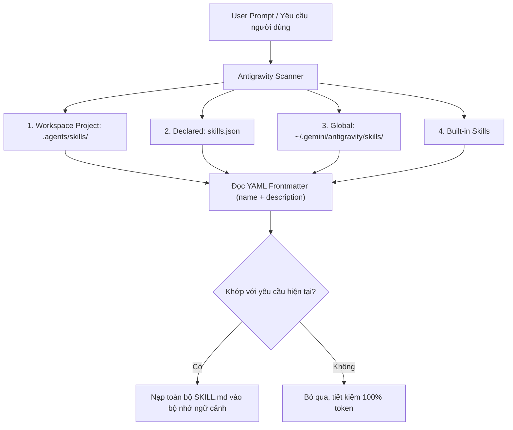

# Hướng Dẫn Sử Dụng Vietnam Agentic Skills (VAS) Cho Google Antigravity

Vietnam Agentic Skills (VAS) được thiết kế và tối ưu hoá trực tiếp cho **Google Antigravity**, cho phép lập trình viên và AI agent dễ dàng khai thác hơn 2,921+ playbooks chuyên nghiệp mà **hoàn toàn không cần dùng `npx` hay cài đặt package Node.js cồng kềnh**.

---

## 1. Cơ Chế Hoạt Động của Antigravity với Skills

Google Antigravity quản lý và nạp kỹ năng (skills) thông qua cơ chế **Progressive Disclosure** (tiết lộ lũy tiến) theo thứ tự ưu tiên:



### Tại sao lại quan trọng?
Nếu nạp cả 2,921+ file kỹ năng vào ngữ cảnh, token sẽ bị tràn ngay lập tức. Với cơ chế của Antigravity:
1. Bạn chỉ cần cài đặt (hoặc link) các kỹ năng bạn muốn vào `.agents/skills/` trong project hoặc `~/.gemini/antigravity/skills/` toàn cục.
2. Antigravity chỉ quét tiêu đề và phần tóm tắt (`description`).
3. Khi bạn yêu cầu thực hiện một tác vụ tương ứng, Antigravity tự động kích hoạt và làm theo đúng quy trình chuẩn trong file `SKILL.md`.

---

## 2. Điểm Khác Biệt: Không Cần NPX

| Tiêu chí | Bản Gốc (Upstream) | Vietnam Agentic Skills (VAS) |
| :--- | :--- | :--- |
| **Công cụ chạy** | Bắt buộc `npx agentic-awesome-skills ...` | Native Python 3 CLI (`./vas` hoặc `python3 vas.py`) |
| **Phụ thuộc bên ngoài** | Node.js, NPM registry, download qua mạng | **Zero dependencies** (chạy trực tiếp từ repo cục bộ) |
| **Mục tiêu ưu tiên** | Đa nền tảng chung | **Tối ưu hóa chuyên sâu cho Google Antigravity** |
| **Chế độ cài đặt** | Copy thủ công | Hỗ trợ cả **Symlink** (`--mode link`) và **Copy** |
| **Tốc độ thực thi** | Mất thời gian tải qua npx mỗi lần | **Gần như tức thì (< 0.1s)** |

---

## 3. Các Luồng Làm Việc Điển Hình

### Kịch bản 1: Cài đặt cho một Dự án Cụ thể (Workspace Target)
Khi bạn đang mở một project code (ví dụ: `my-web-app`) và muốn bổ sung các kỹ năng bảo mật và tối ưu frontend:

```bash
# 1. Di chuyển vào thư mục dự án của bạn
cd /path/to/my-web-app

# 2. Tìm kiếm kỹ năng phù hợp
/path/to/vietnam-agentic-skills/vas search "react performance"

# 3. Cài đặt kỹ năng dạng symlink vào project hiện tại (.agents/skills)
/path/to/vietnam-agentic-skills/vas install react-performance --target workspace --mode link

# 4. Kiểm tra trạng thái
/path/to/vietnam-agentic-skills/vas status
```

Giờ đây, mỗi khi bạn mở dự án đó trong Google Antigravity, trợ lý Antigravity sẽ tự động nhận diện và áp dụng quy chuẩn `react-performance`.

---

### Kịch bản 2: Cài đặt Toàn Cục (Global Target)
Nếu bạn muốn một kỹ năng luôn luôn sẵn sàng cho Antigravity ở bất kỳ thư mục hay dự án nào:

```bash
./vas install 007 --target global
./vas install docker-security --target global
```
Kỹ năng sẽ được cài đặt trực tiếp vào `~/.gemini/antigravity/skills/` và được Antigravity tải tự động.

---

### Kịch bản 3: Cài đặt theo Nhóm (Batch by Category hoặc Tag)
Bạn bắt đầu một dự án DevOps hoặc AI/ML và muốn trang bị trọn bộ kỹ năng thuộc nhóm đó:

```bash
# Cài đặt tất cả kỹ năng thuộc nhóm devops
./vas install --category devops --target workspace

# Cài đặt tất cả kỹ năng có tag python
./vas install --tag python --target workspace
```

---

## 4. Quản lý và Gỡ bỏ Kỹ năng

Để xem danh sách kỹ năng đã cài đặt:
```bash
./vas status
```

Để gỡ bỏ một kỹ năng:
```bash
./vas uninstall <skill_id>
# Ví dụ:
./vas uninstall 007
```

---

## 5. Tự động Khởi tạo Workspace Mới

Bạn có thể chạy lệnh sau trong bất kỳ thư mục dự án nào để tạo cấu trúc `.agents/skills` chuẩn và nạp meta-skill của VAS:
```bash
/path/to/vietnam-agentic-skills/vas init
```
Sau đó, trợ lý Antigravity có thể tự động đọc catalog và tự cài đặt kỹ năng nó cần trong suốt phiên làm việc!
