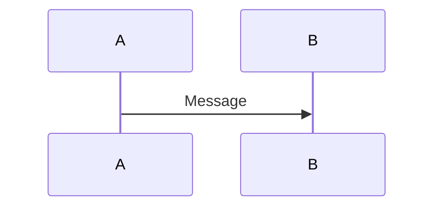

# Diagrams in Google Docs

There are three ways to get a diagram into a Google Doc: let `sync` render
Graphviz DOT (and basic sequence) code blocks for you, pre-render the diagram to
a PNG yourself and insert it, or create one with Antigravity's `generate_image`
tool and insert that.

Reach for them in that order. Code-based diagrams stay diffable in your markdown
source and render text exactly; generated images are best for conceptual or
illustrative visuals where precise labels matter less.

## 1. Code-Based Diagrams (via `sync`)

When you run `"$GDOCS" mutate sync`, the CLI detects code blocks for specific
diagram types in your local Markdown file, renders them to PNG, and inserts them
into the Google Doc.

Supported diagram types:

-   **Graphviz DOT**: Blocks starting with ` ```dot`
-   **Sequence Diagrams**: Blocks starting with ` ```sequence-diagram` (uses
    `js-sequence-diagrams` syntax)
-   **Mermaid**: Blocks starting with ` ```mermaid`. The CLI maps them to the
    `sequence` diagram type (ideal for sequence diagrams, and *only* for those —
    see the warning below).

> [!IMPORTANT] **Rendering requires Graphviz.** Every diagram type above is
> ultimately rendered by shelling out to a `dot` binary found on your `PATH`,
> including the sequence and Mermaid types, which are first translated into DOT.
> Install Graphviz (which provides `dot`) before running `sync` on a file with
> diagrams. If `dot` is missing, `sync` does **not** fail: it logs a warning and
> leaves the diagram's code block in the document as literal text. The
> `--local_graphviz` flag is a no-op — rendering is always local.

> [!WARNING] **Only basic Mermaid sequence diagrams are rendered by `sync`.** If
> you use non-sequence Mermaid diagrams (e.g., flowcharts or class diagrams) in
> your local Markdown file, `sync` will not fail. Instead, it will silently
> succeed but insert a **blank/empty image** in the Google Doc, because the
> sequence-diagram parser ignores all non-matching lines. For those diagrams,
> use section 4.
>
> **Sequence Diagram Rendering Quirk**: the vertical lifelines in the rendered
> image appear as solid lines with arrowheads pointing downwards rather than
> dashed lines. This is a minor layout quirk of the sequence-to-DOT translation.

**Workflow:** Simply write your diagram in your local Markdown file:

```sequence-diagram
A->B: Message
```

Or using Mermaid syntax:



When you run `"$GDOCS" mutate sync DOC_ID file.md`, the CLI will:

1.  Render the diagram to a PNG image with `dot`.
2.  Upload the image to a temporary location in Drive.
3.  Insert the image into the Google Doc.
4.  Insert a text tracking marker `[CC:MANAGED_DIAGRAM:hash]` below the image to
    identify the diagram and avoid redundant updates in future syncs.

## 2. Inserting a Pre-Rendered Diagram Image

Every other approach on this page ends the same way: you have a rendered image
on disk and you put it in the document. The relevant commands are:

```bash
# Insert a local file (uploads it to Drive, then embeds it)
"$GDOCS" mutate insert-image-from-file DOC_ID /tmp/diagram.png --after "System Overview"

# Insert an image already hosted at a URL
"$GDOCS" mutate insert-image DOC_ID "https://example.com/diagram.png" --index 300

# Swap the bytes of an existing image, keeping its position and sizing
"$GDOCS" readonly list-images DOC_ID              # find OBJECT_ID
"$GDOCS" mutate replace-image-safe DOC_ID /tmp/diagram_v2.png --image-id OBJECT_ID

# Add or fix alt text on an image that is already in the document
"$GDOCS" mutate set-alt-text DOC_ID --image-id OBJECT_ID --title "MERMAID" --description "flowchart TD..."
```

Placement flags shared by `insert-image` and `insert-image-from-file`:

| Flag                               | Effect                                |
| ---------------------------------- | ------------------------------------- |
| `--after "text"`                   | insert after the paragraph containing |
:                                    : this text                             :
| `--index N`                        | insert at an explicit index (default: |
:                                    : the start of the body)                :
| `--replace`                        | replace the content at `--index`      |
:                                    : (deletes 1 character there)           :
| `--tab TAB_ID`                     | target a specific tab instead of the  |
:                                    : first one                             :
| `--alt-title`, `--alt-description` | set alt text as part of the insert    |
| `--alt-description-file`           | read the alt description from a file  |

> [!CAUTION] **PNG or JPEG only — SVG is rejected.** Passing an `.svg` file to
> `insert-image-from-file`, or referencing one from a Markdown file that you
> `import-md` or `sync`, fails with `SVG conversion is not available; convert
> the image to PNG or JPEG first`. Render (or convert) to PNG before you insert.
> Files larger than 20MB are also rejected.

> [!TIP] There are no width or height flags: the image goes in at its natural
> size. Control the size when you render it — e.g. `mmdc -w 1400`, or `dot
> -Gdpi=150` — rather than after the fact.
>
> Put the diagram's source code in the alt description (`--alt-title "MERMAID"
> --alt-description "flowchart TD..."`, or `--alt-description-file diagram.mmd`
> for anything long). The document then carries everything needed to regenerate
> the picture, and `readonly list-images` will show it back to you on the next
> edit. It is also the alt text a screen reader announces, so give every image
> at least a one-line description even when you skip the source.

## 3. AI-Generated Diagrams

For conceptual, architectural, or illustrative visuals — the kind that DOT and
Mermaid are a poor fit for — Antigravity provides a **`generate_image`** tool
that creates an image from a text prompt. Generate the image, then insert it
with the CLI.

`generate_image` is an agent tool call, not a shell command. It takes:

| Parameter     | Required | Purpose                                          |
| ------------- | -------- | ------------------------------------------------ |
| `Prompt`      | yes      | What to draw, or how to edit the supplied images |
| `ImageName`   | yes      | Lowercase underscored name, max 3 words (e.g.    |
:               :          : `auth_flow_diagram`)                             :
| `AspectRatio` | no       | One of `1:1` (default), `2:3`, `3:2`, `3:4`,     |
:               :          : `4\:3`, `9\:16`, `16\:9`                         :
| `ImagePaths`  | no       | Up to 3 existing images to edit, combine, or use |
:               :          : as style references                              :

The result is saved as an image artifact. Pass that path to `mutate
insert-image-from-file`:

```bash
# After generate_image has produced the artifact:
"$GDOCS" mutate insert-image-from-file DOC_ID /path/to/generated_image.png \
  --after "System Overview" \
  --alt-description "Architecture diagram: client, API gateway, and three services"
```

> [!TIP]
>
> **Set `AspectRatio` rather than cropping afterwards.** The default is `1:1`,
> which leaves wide whitespace margins on a diagram that wants to be landscape.
> `16:9` or `4:3` suits most architecture and flow diagrams; `3:4` or `9:16`
> suits tall decision trees. Getting this right at generation time is far more
> reliable than post-hoc cropping.

**Iterating on a diagram.** Pass the previous image back via `ImagePaths` with a
prompt describing the change ("same diagram, but add a cache layer between the
API and the database"). This preserves the visual style across revisions, which
matters when a document contains several related diagrams. You can also supply a
reference image to match an existing diagram's look.

**Prompt tips for `generate_image`:**

-   Ask for "clean white background, modern flat design, suitable for a
    technical document".
-   Be specific about boxes, colors, arrows, and layout direction.
-   Mention "no text shadows, crisp lines" for readability.
-   For flowcharts: "rounded rectangles with pastel colors, arrows left to
    right".
-   For architecture: "colored boxes with icons, arrows connecting components".

> [!WARNING]
>
> Image models are unreliable at rendering text. Proofread every label in a
> generated diagram before inserting it — misspelled component names are the
> most common defect. If a diagram is mostly boxes-and-labels, prefer Graphviz
> DOT (§1), which renders text exactly and stays diffable in the markdown
> source.

If you do need to trim excess whitespace and ImageMagick happens to be
installed, this works — but treat it as optional, not part of the workflow:

```bash
convert diagram.png -fuzz 5% -trim +repage -bordercolor white -border 10x10 diagram_cropped.png
```

**Batch approach — create a full doc with images in two steps:**

```bash
# Step 1: Batch all text content (headings, paragraphs, bullets)
"$GDOCS" mutate batch DOC_ID -f content.json --replace-all
# Step 2: Insert images one at a time using --after
"$GDOCS" mutate insert-image-from-file DOC_ID levels.png --after "AI Capability"
"$GDOCS" mutate insert-image-from-file DOC_ID arch.png --after "Architecture"
```

The `batch` command also supports `insert-image-from-file` as an op (pre-uploads
files to Drive, then inserts). Use `image_path` instead of `image_uri`:

```json
{"op":"insert-image-from-file","image_path":"path/to/diagram.png"}
```

> [!NOTE]
>
> For documents with many images (5+), the two-step approach (batch text, then
> individual image inserts) is more reliable than including all
> `insert-image-from-file` ops in a single batch, because temporary Drive URIs
> may expire before the batch completes.

## 4. Programmatic Workflows for Non-Sequence Mermaid Diagrams (Flowcharts, Class Diagrams, etc.)

Since non-sequence Mermaid diagrams will be rendered as blank/empty images by
`sync`, you must choose one of the following workflows.

### Approach A: Translate to Graphviz DOT (Recommended for Sync Tracking)

To ensure the diagram is automatically tracked by `sync` and does not drift on
subsequent runs:

1.  Translate the Mermaid diagram (flowchart, class diagram, or sequence diagram
    if custom layout control is required) into equivalent Graphviz DOT syntax.
    (Note: sequence, class, and flowchart diagrams written directly in DOT are
    fully supported and compile successfully via `sync`).
2.  Replace the ` ```mermaid ` block with a ` ```dot ` block containing the DOT
    syntax in your local Markdown file.
3.  **Graphviz Layout Configuration**:

    -   For flowcharts: layout direction can be horizontal (`rankdir="LR"`) or
        vertical (`rankdir="TB"`).
    -   For sequence diagrams: to ensure lifelines remain vertical and straight
        (avoiding crooked/crossed timelines), you **must** assign layout weights
        to the edges.

        **DOT Edge Weights Pattern:**

        ```dot
        // Lifelines (high weight keeps them straight)
        p0 -> p0_0 -> p0_1 [style=solid, weight=5];
        p1 -> p1_0 -> p1_1 [style=solid, weight=5];

        // Messages (weight=0 prevents horizontal message arrows from bending lifelines)
        p0_0 -> p1_0 [label="Hello Bob!", style=solid, weight=0];
        p1_1 -> p0_1 [label="Hi Alice!", style=dashed, weight=0];
        ```

4.  Run `sync` to automatically compile and insert the diagram with a tracking
    marker.

### Approach B: Pre-Render the Mermaid Yourself, Then Reference the Image

The CLI has no Mermaid renderer of its own beyond the sequence-diagram path in
section 1, so for every other Mermaid diagram type you render the PNG with a
Mermaid renderer you supply and hand the CLI the finished image. The reference
open-source renderer is
[`@mermaid-js/mermaid-cli`](https://github.com/mermaid-js/mermaid-cli) (`mmdc`),
but any renderer that produces a PNG works.

1.  **Whole-file preprocessing (recommended before `import-md` or `sync`)**:
    `mmdc` accepts a Markdown file as input. It renders each ` ```mermaid `
    block to an image next to the output file and rewrites the block into a
    local image link:

    ```bash
    npx -p @mermaid-js/mermaid-cli mmdc -i /tmp/doc.md -o /tmp/rendered/doc.md -b white -s 2
    ```

    Then import or sync the rewritten file:

    ```bash
    "$GDOCS" mutate import-md /tmp/rendered/doc.md --title "Doc Title"
    ```

    Both `import-md` and `sync` detect local image links in the Markdown, upload
    them to Drive as temporary documents, and embed them in the Google Doc, so
    no separate insert step is needed.

2.  **One diagram at a time**: render the block on its own and insert it where
    you want it, keeping the source in the alt text:

    ```bash
    npx -p @mermaid-js/mermaid-cli mmdc -i /tmp/flow.mmd -o /tmp/flow.png -b white -s 2
    "$GDOCS" mutate insert-image-from-file DOC_ID /tmp/flow.png \
      --after "System Overview" \
      --alt-title "MERMAID" --alt-description-file /tmp/flow.mmd
    ```

> [!IMPORTANT] Write the PNG, not the SVG. `mmdc` defaults to SVG output when
> `-o` is omitted, and the CLI rejects SVG input (see section 2). Always pass an
> `-o` path ending in `.png`.

> [!CAUTION] **Sync Drift Risk**: static image links do not carry a
> `[CC:MANAGED_DIAGRAM]` tracking marker in the Google Doc. Because their local
> path differs from the remote content URI, `sync` may fail to match them on
> subsequent runs, leading to duplication or deletion. Use Approach A if you
> plan to edit the document text frequently.

## Known Edge Cases and Limitations

When using `"$GDOCS" mutate sync` with diagrams, be aware of the following edge
cases:

1.  **Insertion at Document Boundary**: When inserting a diagram at the very end
    of a document (or a segment), the API may fail if the target index is equal
    to the segment's end index. The CLI includes a boundary check to prevent
    this by ensuring the target index is strictly less than the segment end.
2.  **Escaped Brackets in Markers**: In some markdown environments, brackets in
    markers like `[CC:MANAGED_DIAGRAM:...]` might become escaped as
    `\[CC:MANAGED_DIAGRAM:...\]`. The CLI parses both formats to correctly
    identify managed diagrams.
3.  **Syncing to Tabbed Documents**: The `sync` command supports targeting
    specific tabs using the `--tab TAB_ID` option.
    -   If no `--tab` is specified, `sync` falls back to the first tab.
    -   You can synchronize text and diagrams directly to any tab by passing its
        corresponding tab ID: `"$GDOCS" mutate sync DOC_ID local_file.md --tab
        TAB_ID`

## 5. Local Rendering Fallback (Workaround)

If diagram rendering during `sync` fails or jumbles the layout, you can render
the diagram yourself and insert it manually. This is the most reliable fallback
for complex Graphviz DOT diagrams.

### Workflow

1.  **Extract and Convert the diagram**:
    *   If you have a **Graphviz DOT** block, save it to a temporary file (e.g.,
        `diagram.dot`).
    *   If you have a **Mermaid** block, either render it with `mmdc` (Approach
        B above) or convert its structure to Graphviz DOT syntax and save it to
        `diagram.dot`.
2.  **Render locally**: Use the `dot` CLI (Graphviz) to compile it to a PNG:

    ```bash
    dot -Tpng /path/to/diagram.dot -o /path/to/diagram.png
    ```

3.  **Prepare the document**: Remove the diagram code block from your local
    Markdown file to avoid importing raw code text, leaving a blank line or
    placeholder.

4.  **Sync text**: Synchronize the text-only markdown file to Google Doc:

    ```bash
    "$GDOCS" mutate sync DOC_ID file.md
    ```

    > [!NOTE] `sync` targets the first tab of a document unless you pass
    > `--tab`. To write text content to another tab you can also use `import-md`
    > with `--tab` and `--update` (which clears the target tab).

5.  **Insert image**: Insert the rendered PNG image explicitly after the target
    paragraph:

    ```bash
    # For single-tab documents (or first tab):
    "$GDOCS" mutate insert-image-from-file DOC_ID /path/to/diagram.png --after "Paragraph text preceding the diagram"

    # For other tabs in tabbed documents (requires --tab):
    "$GDOCS" mutate insert-image-from-file DOC_ID /path/to/diagram.png --tab TAB_ID --after "Paragraph text preceding the diagram"
    ```

> [!WARNING] **Sync Drift Risk**: Manually inserted images (inserted via
> `insert-image-from-file`) do not contain tracking markers and are not linked
> to the local Markdown source. While the sync tool attempts to preserve them as
> remote-only changes during 3-way merges, they may be displaced or deleted
> during major text refactors of the surrounding content. Always keep a backup
> of the rendered PNG and verify the document structure after subsequent
> syncs. 6. **Sync Failures after Import**: If a document was newly created via
> `import-md`, a subsequent `sync` to render diagrams may fail with `Invalid
> deletion range` or conflicts (due to GDocs auto-formatting and AST drift).

*   **Workaround**:

    1.  **Strip diagrams**: Remove ```` ```mermaid```` or ```` ```dot```` blocks
        from the source Markdown file.
    2.  **Import clean Markdown**: Run `"$GDOCS" mutate import-md` on the
        stripped file. This will create a **new** document and return a new
        `NEW_DOC_ID`.
    3.  **Render locally**: render DOT blocks to PNG with `dot -Tpng`, and
        Mermaid blocks to PNG with `mmdc -o out.png`. If neither renderer is
        installed, install Graphviz for `dot` and convert the Mermaid diagrams
        to DOT.
    4.  **Insert manually**: Use `"$GDOCS" mutate insert-image-from-file
        NEW_DOC_ID output.png --after "paragraph text"` to place the images in
        the newly created document.
    5.  **Apply styling**: restyle the new document as needed — see
        [`styling.md`](styling.md).
